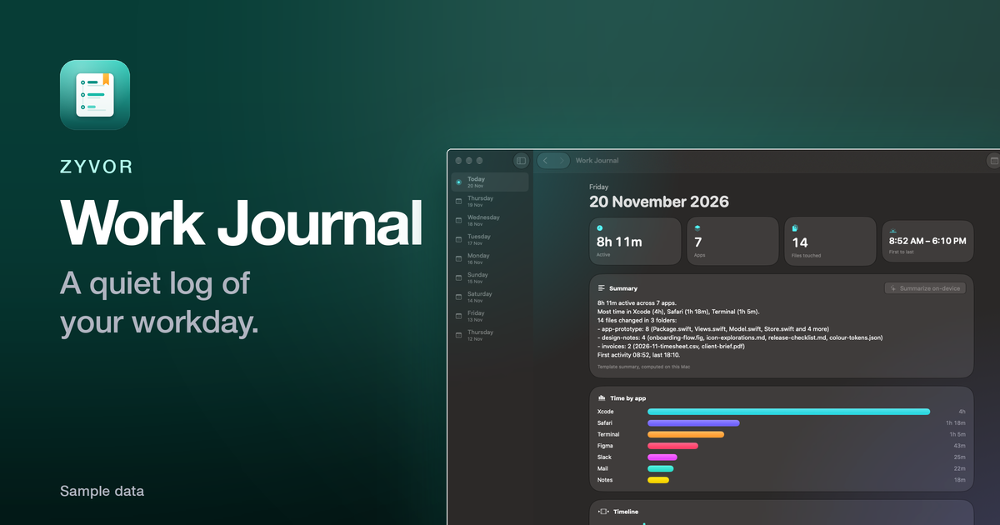
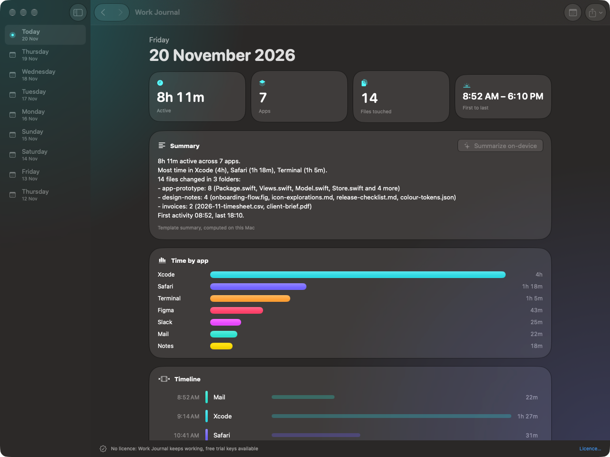
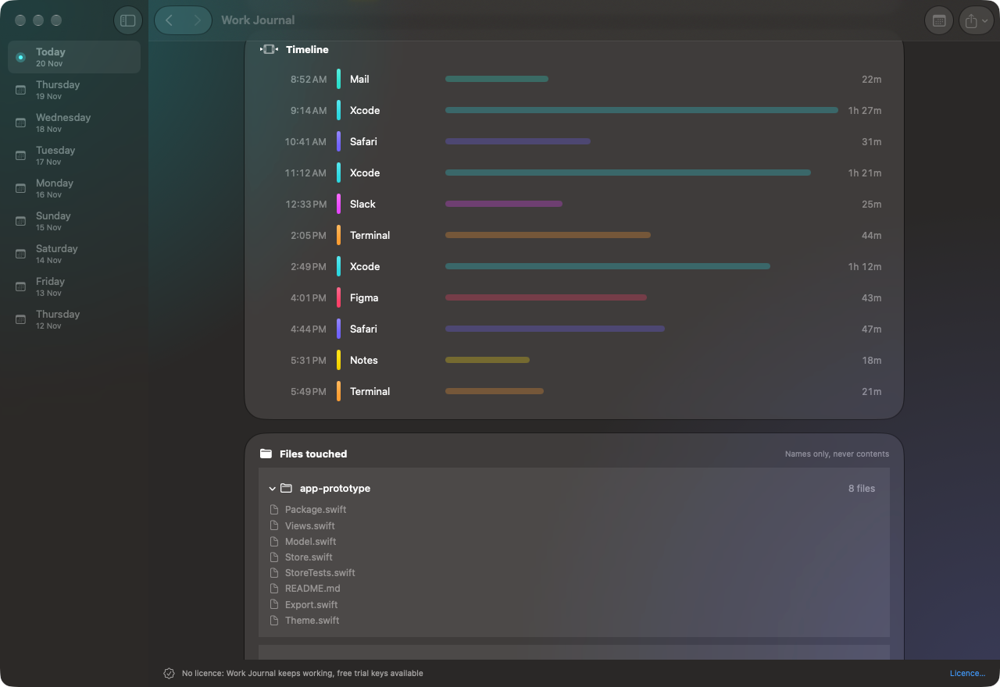
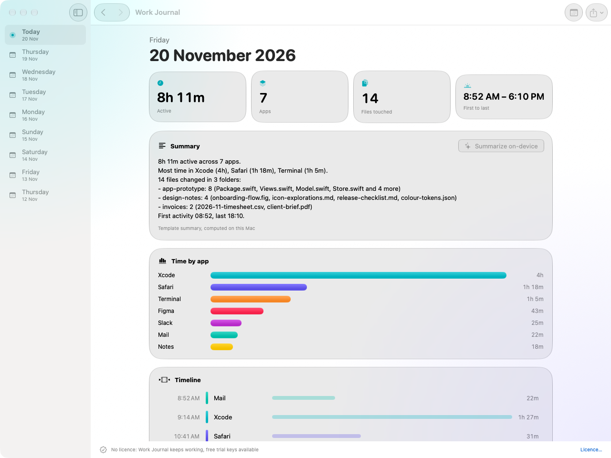
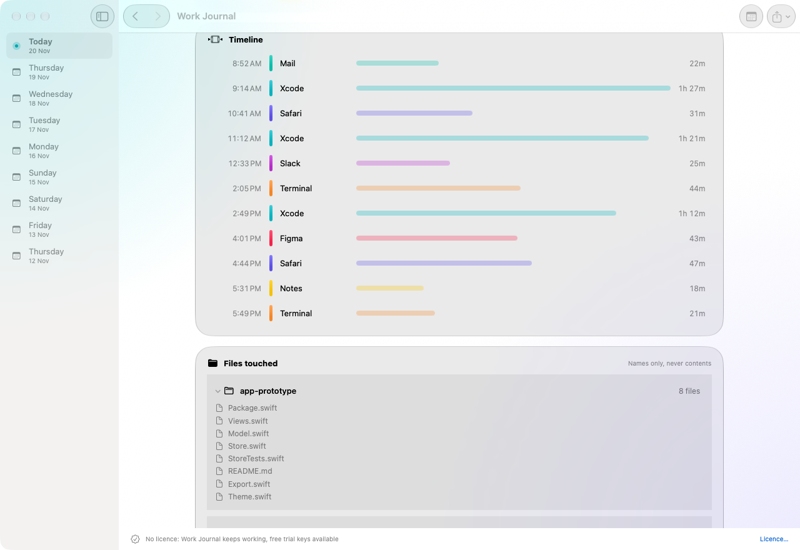
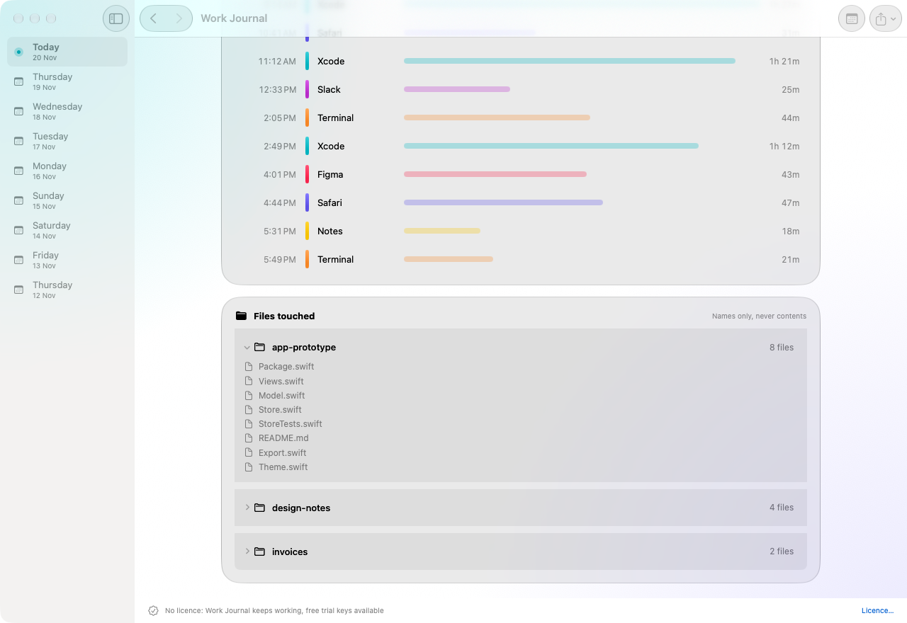
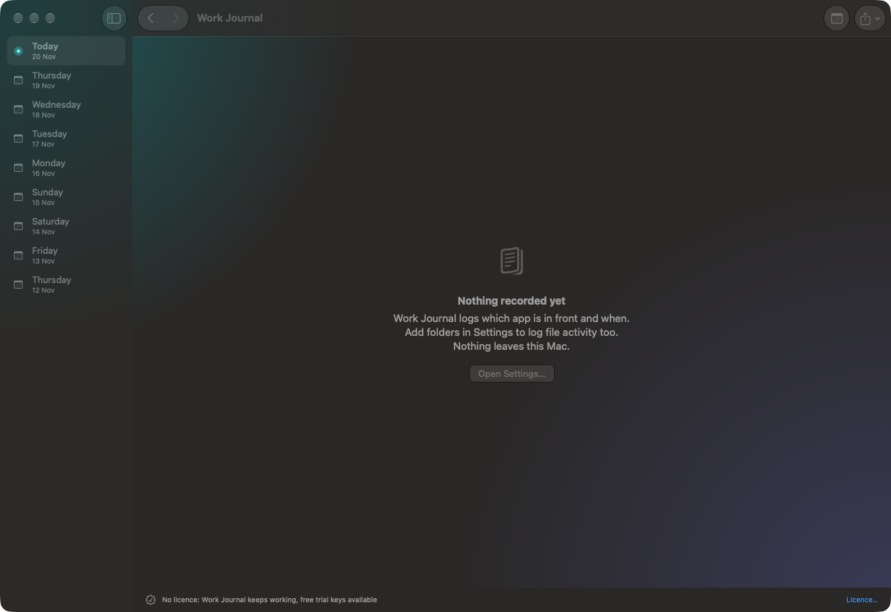
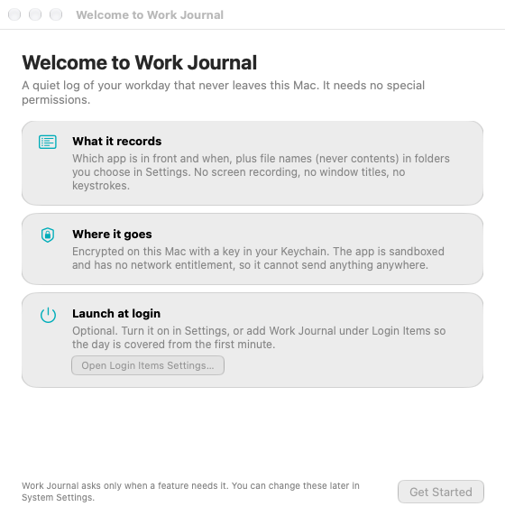

<div align="center">



# Work Journal

### A quiet log of your workday.

Which app was in front, which files changed in the folders you choose, turned into a timeline, a summary, a timesheet or a standup note. Encrypted on your Mac, sandboxed, no network entitlement.

<br />

**[Download the 30-day trial](https://github.com/zyvorai/work-journal/releases/tag/v0.1.1)** &nbsp;·&nbsp; [Website](https://zyvorai.github.io/work-journal/) &nbsp;·&nbsp; [Docs](docs/README.md) &nbsp;·&nbsp; Licences: [sales@zyvor.dev](mailto:sales@zyvor.dev?subject=Work%20Journal%20licence)

`WorkJournal-0.1.1.dmg` · macOS 27 or later · Apple silicon · Developer ID signed and notarized

</div>

---

## Download (trial)

| | |
| --- | --- |
| **Get it** | [Work Journal 0.1.1](https://github.com/zyvorai/work-journal/releases/tag/v0.1.1): `WorkJournal-0.1.1.dmg` (the SHA-256 is in the release notes and in `WorkJournal-0.1.1.dmg.sha256`) |
| **Free 30-day trial key** | **sales@zyvor.dev**. Enter it under **Licence…** in the menu-bar menu. You do not need a key to use the app. |
| **Requirements** | macOS 27 or later, Apple silicon |
| **Notarized** | Developer ID signed and notarized by Apple |

Open the DMG and drag Work Journal to Applications. Install steps: [docs/INSTALL.md](docs/INSTALL.md).

## See it

*These are the real app windows rendered with invented sample data. They are not captures of anyone's journal.*

| Overview | Timeline |
| --- | --- |
|  |  |
|  |  |

| Files | Empty state | Welcome |
| --- | --- | --- |
|  |  |  |

## What it does

- **Records which app is in front, and when.** From the system's frontmost-app notifications. No window titles, no URLs, no screen recording.
- **Logs file activity in folders you choose.** File names and paths only, never contents. Build output, `.git` and similar noise are ignored.
- **Does not count time away.** Sleep, lock, the screen saver and 5 idle minutes end a session.
- **Shows the day.** Sidebar of days, active time, apps and files tiles, a summary, time per app and a timeline.
- **Summarizes on your Mac.** A template summary is always there; **Summarize on-device** uses Apple's Foundation Models framework where your Mac has it. The window says which one you are reading.
- **Exports.** Markdown (standup), timesheet CSV and files CSV, for this day or the last 7 days.
- **Encrypted.** One AES-256-GCM file per day; the key lives only in your Keychain.
- **Checkable privacy.** Sandboxed, with no network entitlement:

```
codesign -d --entitlements :- /Applications/WorkJournal.app
```

lists only `app-sandbox`, `files.user-selected.read-write` and `files.bookmarks.app-scope`. See [docs/PRIVACY.md](docs/PRIVACY.md).

## Requirements and limits

- macOS 27 or later, Apple silicon.
- It records which app is in front, not what you do inside it. File activity is limited to the folders you choose.
- Early release (0.1.1). Beyond its automated self-tests, the interface click-through, the folder picker, launch at login, VoiceOver and a clean-Mac install have not been tested by us.

## Trial and licence

- **Free 30-day trial key: sales@zyvor.dev.** Without a key everything works and a status line says so. After a trial ends, nothing is disabled either.
- **Paid licences:** contact sales@zyvor.dev. Price: INR 2,999 per Mac per year incl. 18% GST in India (about US$30 excl. tax outside India). Teams of 5 or more Macs: INR 2,549 per Mac per year (about US$26 excl. tax), minimum 5 Macs (INR 12,745, about US$129), by invoice. Prices: INR incl. 18% GST in India; US dollars excl. tax elsewhere (VAT, GST or sales tax added where applicable). Pay online by UPI, card or netbanking; international cards work (charged in rupees); or request a US-dollar invoice by bank transfer. Custom pricing: contact sales@zyvor.dev. Buy: [zyvor.dev/buy](https://zyvor.dev/buy#work-journal) (free 30-day trial first).
- Details: [docs/LICENSING.md](docs/LICENSING.md). Licensed under the [Zyvor Production License v1.0](LICENSE): non-production use is free; production use requires a paid commercial licence from Zyvor AI Labs Private Limited. See also [NOTICE](NOTICE).

## Documentation

| Doc | Topic |
| --- | --- |
| [Website](https://zyvorai.github.io/work-journal/) | The product page and docs |
| [Install](docs/INSTALL.md) | Download, verify, install, uninstall |
| [How it works](docs/HOW-IT-WORKS.md) | Recording, storage, summaries, shortcuts |
| [Privacy](docs/PRIVACY.md) | What is and is not recorded, and how to verify it |
| [Exports](docs/EXPORTS.md) | Markdown and CSV formats |
| [Trial and licence](docs/LICENSING.md) | Trial key, status line, terms |
| [FAQ](docs/FAQ.md) | Common questions |
| [Changelog](CHANGELOG.md) · [Security](SECURITY.md) | Release notes, reporting (security@zyvor.dev) |

**The Work Journal source code is private.** This repository holds the documentation, website and downloads.

Copyright © 2026 Zyvor AI Labs Private Limited · [zyvor.dev](https://zyvor.dev)
